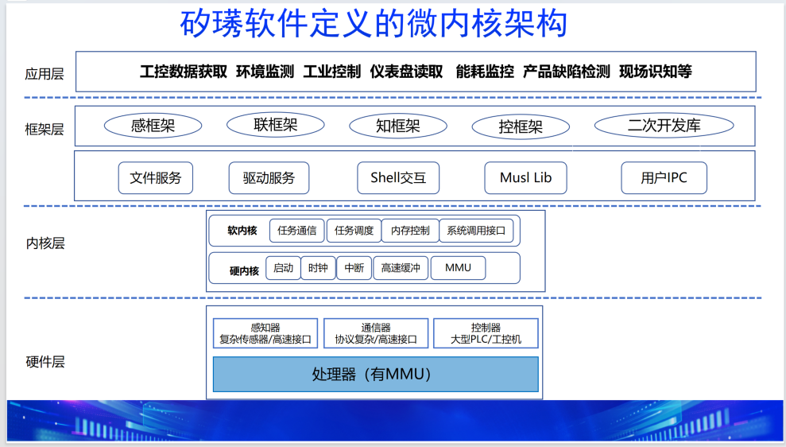

### 1 XiUOS的微内核分支XiZi_AIoT

  &emsp;&emsp;XiZi_AIoT是矽璓操作系统（XiUOS）基于微内核架构的分支，在南向硬件生态上主要是支持具备MMU功能的现代处理器，在北向生态上与基于宏内核架构矽璓操作系统分支共用感联知控应用程序框架。矽璓微内核的区别传统微内核的特征在于将内核层分为硬内核和软内核部分：硬内核仅仅提供对启动，时钟，中断，缓存，MMU等硬件资源的基本抽象，采用解耦合的管理机制提供硬件的核心功能；软内核部分负责任务调度和通信，内存控制及系统调用等功能。所述设计极大提高了微内核的效率，同时增强了内核的安全性。


&emsp;&emsp;如图所示，是矽璓操作系统的微内核架构。硬件层主要包含感知器，通信器，控制器和带有MMU功能的处理器；内核层主要是硬内核和软内核两部分，其运行在内核态；框架层首先是服务形式存在的文件系统，驱动程序，人机交互，C库及用户IPC等，其次是感联知控框架及二次开发库，框架层运行在用户态；最上层是应用层，支持各种工业应用。

### 2 XiUOS的微内核分支XiZi_AIoT的构建

&emsp;&emsp;XiZi_AIoT 支持两种构建和运行方式：基于 QEMU 模拟器构建和基于实际开发板构建。

#### 2.1 基于 QEMU 构建

&emsp;&emsp;QEMU 是一个强大的模拟器工具，可用于在没有实际硬件的情况下测试 XiZi_AIoT。

1. **构建命令**：
   在 xiuos/Ubiquitous/XiZi_AIoT 目录下运行命令：
   ```
   make BOARD=imx6q-sabrelite
   ```
   默认情况下，运行 `make` 等同于 `make BOARD=imx6q-sabrelite`。

2. **运行命令**：
   构建完成后，使用以下命令在 QEMU 中运行：
   ```
   qemu-system-arm -M sabrelite -m 1G -smp 4 -cpu cortex-a9 \
       -display none -serial null -serial stdio \
       -kernel xiuos/Ubiquitous/XiZi_AIoT/build/XiZi-imx6q-sabrelite.elf
   ```
   将 "xiuos/Ubiquitous/XiZi_AIoT/build/XiZi-imx6q-sabrelite.elf" 替换为您目录中的适当路径。

3. **QEMU 版本建议**：
   我们建议使用 "QEMU emulator version 7.2.0" 来成功模拟 sabrelite 板。

#### 2.2 基于实际开发板或者终端的构建

对于实际物理开发板，XiZi_AIoT 支持以下处理器：
- [imx6q-sabrelite](services/boards/imx6q-sabrelite/README.md)
- [RK3568](services/boards/3568-board/README.md)
- [RK3588](services/boards/3588-board/README.md)
- [VisionFive2](services/boards/VisionFive2/README.md)
- [zynq7000-zc702](services/boards/zynq7000-zc702/README.md)

**构建命令**：
在 xiuos/Ubiquitous/XiZi_AIoT 目录下运行命令：
```
make BOARD=$(BOARD)
```
其中 `$(BOARD)` 替换为您的开发板名称（如 `imx6q-sabrelite`、`3568-board`、`3588-board`、`VisionFive2` 或 `zynq7000-zc702`）。

**详细说明**：
有关特定开发板的编译过程、烧录方法和配置详情，请查看对应的 `services/boards/$(BOARD)/README.md` 文件。

### 3 XiZi_AIoT的Makefile使用

&emsp;&emsp;XiZi_AIoT 使用 Makefile 构建所有文件，包括 .c 和 .S 文件。compiler.mk 文件使 make 工具能够遍历 *SRC_DIR* 定义的所有子目录，并使用 config.mk 中定义的参数编译 *SRC_FILES* 定义的文件。每个板在 hardkernel/arch/.../config.mk 中独立定义其 config.mk 文件。此外，path_kernel.mk 定义了 XiZi_AIoT 所需的所有包含路径，而 link.mk 在所有 .c 和 .S 文件编译完成后管理链接过程。