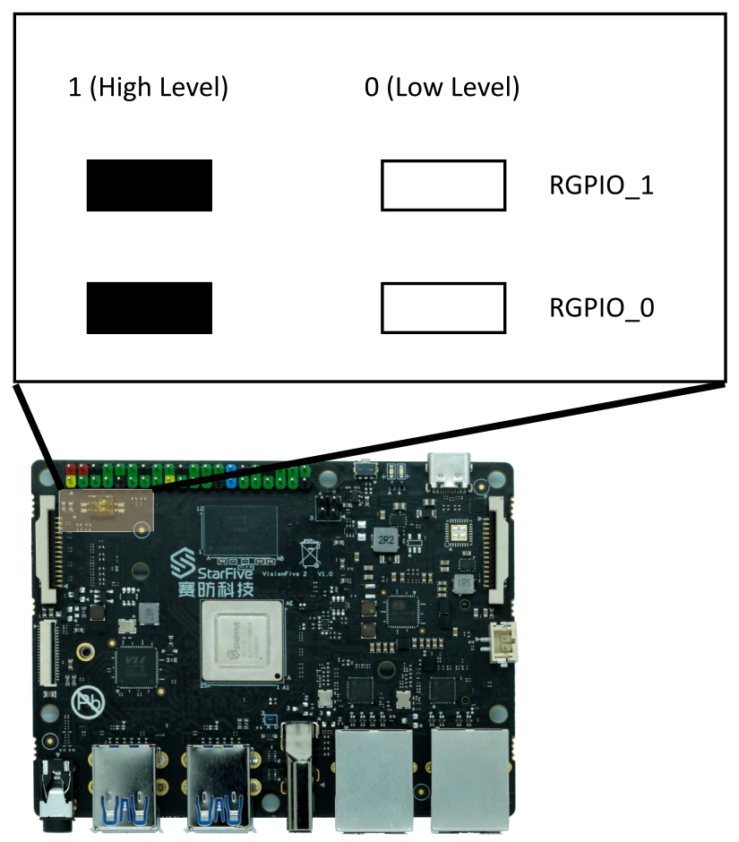
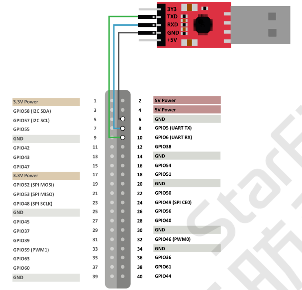
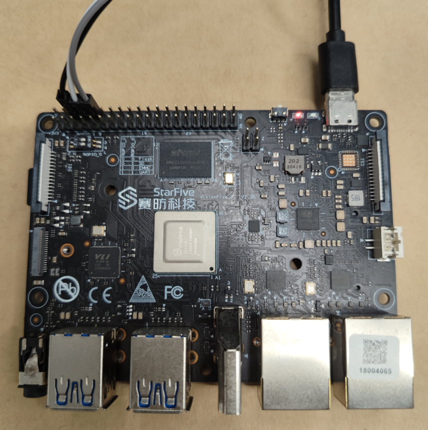
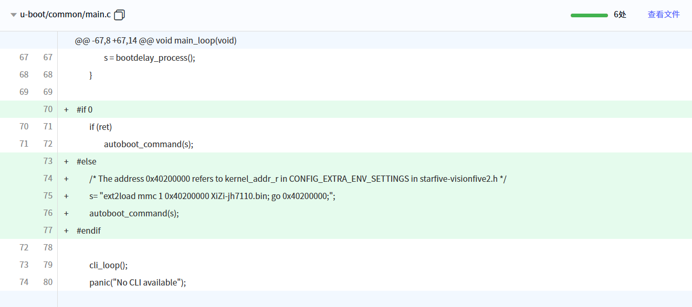
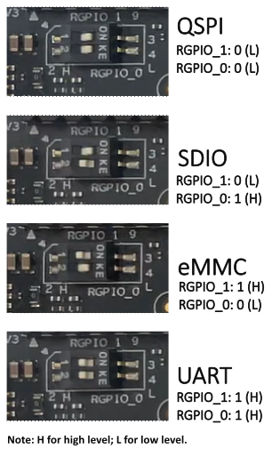
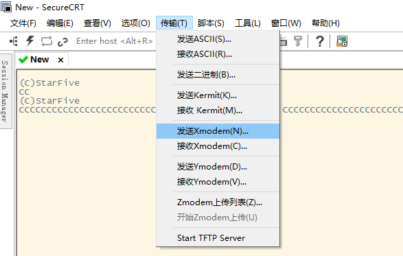
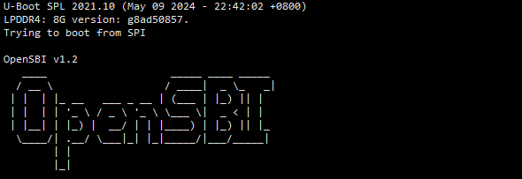
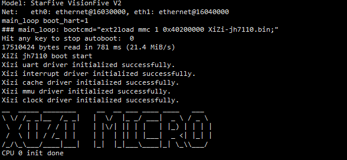
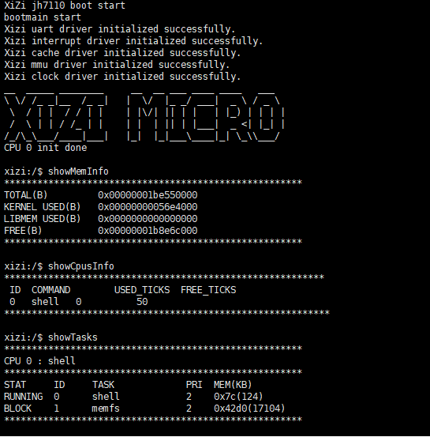
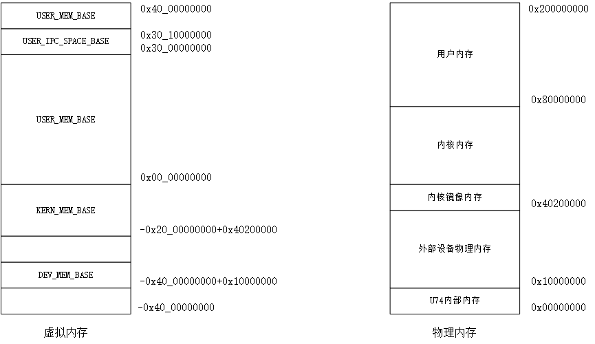

# 从零开始构建矽璓微内核操作系统：RISC-V架构VisionFive2开发板

[XiUOS](http://xuos.io/) (X Industrial Ubiquitous Operating System) 矽璓XiUOS是一款面向智慧车间的工业物联网操作系统，主要由一个极简的微型实时操作系统内核和其上的工业物联框架构成，通过高效管理工业物联网设备、支撑工业物联应用，在生产车间内实现智能化的“感知环境、联网传输、知悉识别、控制调整”，促进以工业设备和工业控制系统为核心的人、机、物深度互联，帮助提升生产线的数字化和智能化水平。

## 开发环境搭建

### 推荐使用：

**操作系统：** Ubuntu 20.04 下载网址：https://ubuntu.com/download/desktop

### 依赖包安装：

```
$ sudo apt install build-essential pkg-config
$ sudo apt install gcc make libncurses5-dev openssl libssl-dev bison flex libelf-dev autoconf libtool gperf libc6-dev  git
```

### 源码下载：

下载矽璓源码，命令如下：

```c
git clone https://gitlink.org.cn/xuos/xiuos.git
```

1、打开XiUOS源码文件包可以看到以下目录：

| 名称          | 说明                                                         |
| ------------- | ------------------------------------------------------------ |
| APP_Framework | 应用代码。                                                   |
| Ubiquitous    | 板级支持包，支持NuttX、RT-Thread、XiZi_IIoT_Macro和XiZi_AIoT_Micro。 |


2、打开XiZi_AIoT_Micro微内核源码文件包，可以看到以下主要目录：

| 名称 | 说明 |
| -- | -- |
| hardkernel | 负责硬件相关的初始化，如时钟驱动、中断处理等底层硬件管理，为上层软内核提供硬件支持。 |
| softkernel | 微内核核心功能实现，如任务管理、内存管理、进程间通信等。 |
| services | 各类服务和应用模块。其中，boards针对不同硬件板卡的适配代码。 |
| Makefile | 构建脚本，支持多架构（ARM、RISC-V）和不同板卡的编译配置。 |


# VisionFive2开发板

## 1. 微处理器简介

| 硬件 | 描述 |
| -- | -- |
|芯片型号| JH7110 |
|CPU| RISC-V 四核64位RV64GC |
|主频| 1.5 GHz |
|内存| 8GB |
|存储| 16MB+TF卡 |
| 外设 | 目前仅支持UART调试 |

## 2. 编译说明

### 2.1 交叉编译工具链的获取和设置

下载基于JH7110的微内核需要的RISC-V交叉编译工具链：`riscv64-unknown-elf`。

下载链接（百度网盘）：https://pan.baidu.com/s/1H1WQjQGLlT-xfg3-HWCu3Q

提取码：w2wn

文件名：`riscv64-elf-ubuntu-20.04-nightly-2023.01.31-nightly.tar.gz` 

假设压缩包放置路径是`/home/data/`，执行解压命令：

```c
tar -xzvf riscv64-elf-ubuntu-20.04-nightly-2023.01.31-nightly.tar.gz
```

应该可以找到交叉编译工具链：

```c
/home/data/riscv/bin/riscv64-unknown-elf-gcc
```

配置环境变量（编辑 `~/.bashrc`）：

```c
export PATH="/home/data/riscv/bin:$PATH"
```

然后执行 `source ~/.bashrc` 生效。

### 2.1 微内核编译

编译步骤：

1.进入Ubiquitous/XiZi_AIoT_Micro目录，执行命令：

```c
make distclean
make BOARD=jh7110
```

2.如果编译正确无误，会在build文件夹下生成文件：

```c
XiZi-jh7110.bin
```

## 3. SD卡镜像

将 SD 卡插入 Ubuntu 主机（或虚拟机），假设设备为 /dev/sdb。
格式化为 ext2：

```c
mkfs.ext2 /dev/sdb
```


挂载 SD 卡，并将`XiZi-jh7110.bin`拷贝至根目录。

注意：请确认设备名正确，避免误操作系统盘！

## 4. 启动模式设置和串口线连接

### 4.1 启动模式设置

VisionFive2开发板提供专门的pin，帮助用户在上电前配置启动模式。以下是可选的启动模式及其详细信息。

| index | 启动模式             | RGPIO_1 | RGPIO_0 |
| :---- | :------------------- | :------ | :------ |
| 1     | 1-bit QSPI Nor Flash | 0 (L)   | 0 (L)   |
| 2     | SDIO3.0              | 0 (L)   | 1 (H)   |
| 3     | eMMC                 | 1 (H)   | 0 (L)   |
| 4     | UART                 | 1 (H)   | 1 (H)   |

运行 XiZi 微内核：使用 Flash 模式（0,0）
烧录 U-Boot：使用 UART 模式（1,1）

下图显示了启动模式专用pin的位置及其定义。



### 4.2 串口线连接

VisionFive2开发板硬件介绍，可查看官网资料：https://doc.rvspace.org/VisionFive2/Quick_Start_Guide/VisionFive2_QSG/hardware_overview.html

查看官网资料的产品框图和Pin图。

开发板调试串口在40-Pin GPIO 上，需要跳线连接，如下图所示。串口波特率（baud rate）设置为115,200。

```c
Pin6 GND
Pin8 GPIO5 (UART TX)
Pin10 GPIO6 (UART RX)
```



开发板通过type-c端口供电。

实物图如下。



## 5. Uboot

矽璓微内核是由Uboot引导启动。必须烧录Uboot之后，才能启动矽璓微内核！

### 5.1 Uboot适配XiZi

为了方便管理Uboot适配XiZi的代码，我们基于VisionFive2的代码，创建了泛在操作系统实验室的JH7110 Project仓库。

下载JH7110 Project仓库下的分支uboot_xizi代码，命令如下：

```c
git clone -b uboot_xizi https://gitlink.org.cn/xuos/jh7110_project.git
```

注意：是下载uboot_xizi 分支，不是下载master（不加参数-b，默认下载master）。

uboot_xizi 主要修改：在Uboot的函数`main_loop`中，将原来启动Linux的命令替换为从SD卡加载`XiZi-jh7110.bin`并启动的命令。



使用JH7110 Project仓库的uboot_xizi分支的最新代码。

### 5.2 Uboot 编译

VisionFive2开发板Uboot 编译，主要包括以下部分：设置编译环境、编译U-Boot（包含下载源代码）、创建SPL文件、编译OpenSBI、创建fw_payload文件。

具体步骤，查看官网资料：https://doc.rvspace.org/VisionFive2/SW_TRM/VisionFive2_SW_TRM/compiling_u-boot_and_kernel%20-%20vf2.html

需要生成文件：

```c
u-boot-spl.bin.normal.out
visionfive2_fw_payload.img
```

另外，也可以使用JH7110 Project仓库uboot_xizi 分支的编译完的固件，路径：https://gitlink.org.cn/xuos/jh7110_project/tree/uboot_xizi/firmware

### 5.2 Uboot 烧录

VisionFive2开发板烧录U-Boot到Flash，采用恢复Bootloader的方法，主要包括以下部分：启动模式跳线切换为UART模式；使用SecureCRT选择串口及波特率115200；通过XMODEM发送恢复二进制文件（jh7110-recovery-<Version>.bin）；更新SPL二进制文件<u-boot-spl.bin.normal.out>；更新U-Boot二进制文件<visionfive2_fw_payload.img>；跳线切换回Flash模式。

具体步骤，查看官网资料：https://doc.rvspace.org/VisionFive2/Quick_Start_Guide/VisionFive2_SDK_QSG/recovering_bootloader%20-%20vf2.html

如果，官网下载jh7110-recovery-<Version>.bin失败，可以使用 JH7110 Project仓库uboot_xizi 分支的jh7110-recovery-20230322.bin，路径：https://gitlink.org.cn/xuos/jh7110_project/tree/uboot_xizi/firmware

启动模式设置，UART模式（RGPIO_1，RGPIO_0: 1,1）和 QSPI Flash模式（RGPIO_1，RGPIO_0：0，0），如图所示。



SecureCRT通过XMODEM，传输恢复二进制文件，如图所示。



## 6. XiZi启动

检查启动模式跳线已经切换回Flash模式；确保已烧录定制 U-Boot。

将含 XiZi-jh7110.bin 的 SD 卡插入开发板。通过串口终端查看启动日志。

Uboot启动的日志：



Uboot加载XiZi微内核的日志：



输入命令查看内存、cpu、任务等信息。

```c
showMemInfo
showCpusInfo
showTasks
```



## 7. 其他

内存分布以及虚拟地址映射。



