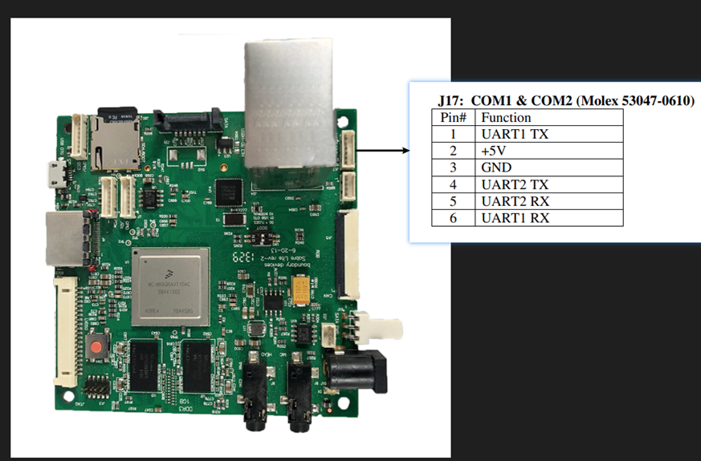
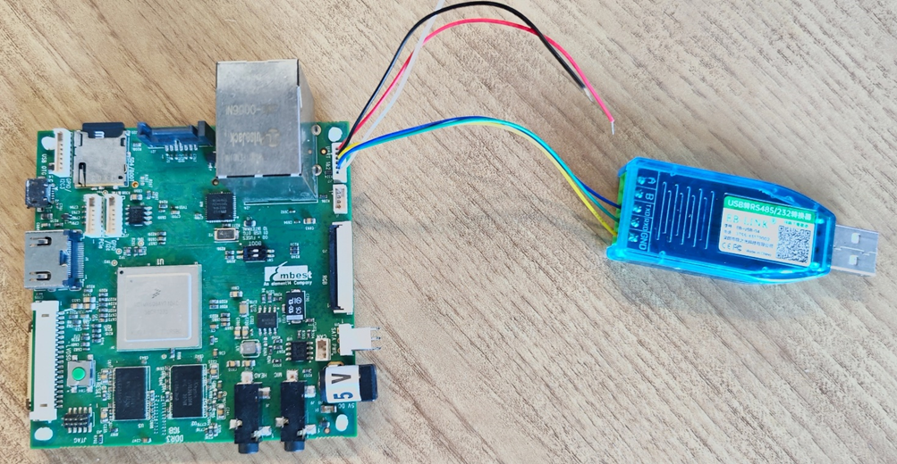
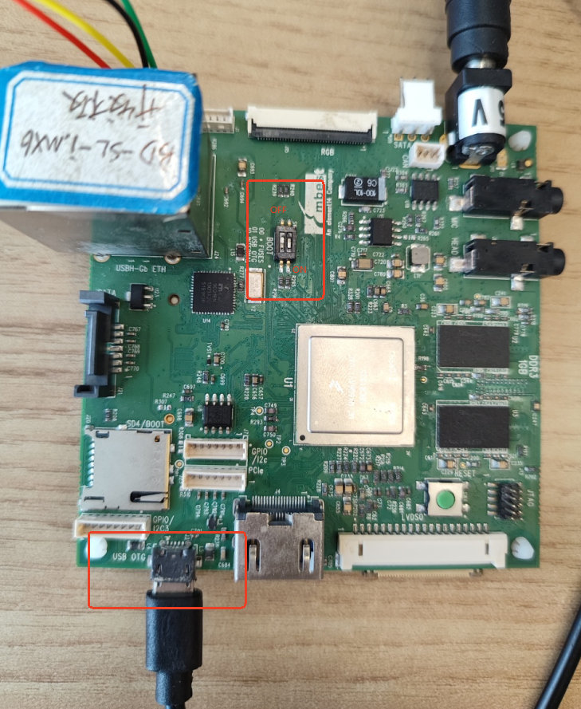
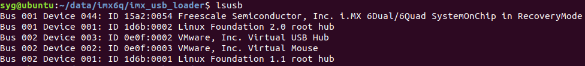
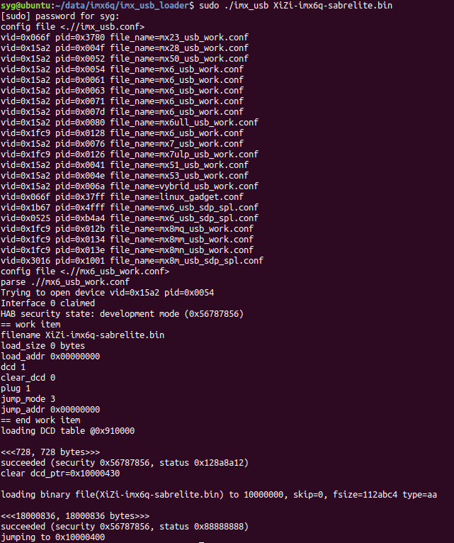
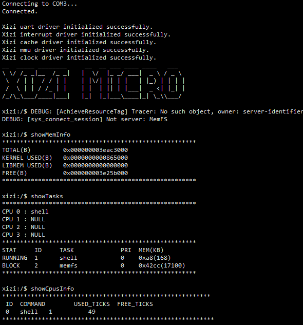

# 从零开始构建矽璓微内核操作系统：ARM架构BD-SL-i.MX6开发板

[XiUOS](http://xuos.io/) (X Industrial Ubiquitous Operating System) 矽璓XiUOS是一款面向智慧车间的工业物联网操作系统，主要由一个极简的微型实时操作系统内核和其上的工业物联框架构成，通过高效管理工业物联网设备、支撑工业物联应用，在生产车间内实现智能化的“感知环境、联网传输、知悉识别、控制调整”，促进以工业设备和工业控制系统为核心的人、机、物深度互联，帮助提升生产线的数字化和智能化水平。

## 开发环境搭建

### 推荐使用：

**操作系统：** Ubuntu 20.04 下载路径：[https://ubuntu.com/download/desktop](https://ubuntu.com/download/desktop)

### 依赖包安装：

```
$ sudo apt install build-essential pkg-config
$ sudo apt install gcc make libncurses5-dev openssl libssl-dev bison flex libelf-dev autoconf libtool gperf libc6-dev  git
```

### 源码下载：

下载矽璓源码，命令如下：

```c
git clone https://gitlink.org.cn/xuos/xiuos.git
```

1、打开XiUOS源码文件包可以看到以下目录：

| 名称          | 说明                                                         |
| ------------- | ------------------------------------------------------------ |
| APP_Framework | 应用代码。                                                   |
| Ubiquitous    | 板级支持包，支持Nuttx_Fusion_XiUOS、RT-Thread_Fusion_XiUOS、XiZi_IIoT_Macro和XiZi_AIoT_Micro。 |


2、打开XiZi_AIoT_Micro微内核源码文件包，可以看到以下目录：

| 名称 | 说明 |
| -- | -- |
| hardkernel | 负责硬件相关的初始化，如时钟驱动、中断处理等底层硬件管理，为上层软内核提供硬件支持。 |
| softkernel | 微内核核心功能实现，如任务管理、内存管理、进程间通信等。 |
| services | 各类服务和应用模块。其中，boards针对不同硬件板卡的适配代码。 |
| Makefile | 构建脚本，支持多架构（ARM、RISC-V）和不同板卡的编译配置。 |


# BD-SL-i.MX6开发板

## 1. 微处理器简介

| 硬件 | 描述 |
| -- | -- |
|芯片型号| i.MX6Q |
|CPU| 四核 ARM Cortex-A9 |
|主频| 1GHz |
|内存| 1GB |
|存储| 4MB SPI NOR + 8GB eMMC |
| 外设 | 目前仅支持UART调试 |

BD-SL-i.MX6套件（以前的SABRE Lite板）是一个低成本的开发平台，具有强大的i.MX6 Quad应用处理器。

## 2. 编译说明

下载基于IMX6Q芯片的微内核需要的交叉编译工具链：`arm-none-eabi-`

交叉编译工具链安装命令：

```c
sudo apt-get install gcc-arm-none-eabi
```

编译步骤：

1.在Ubiquitous/XiZi_AIoT_Micro目录下执行命令：

```c
make distclean
make BOARD=imx6q-sabrelite
```

2.如果编译正确无误，会在build文件夹下生成文件：

```c
XiZi-imx6q-sabrelite.bin
```

## 3. 开发板硬件连接

### 3.1 调试串口连接

调试串口，按照如下图所示的对应关系进行连接。



另外，由于板载RS232转换芯片，所以使用USB转RS232转换器进行连接，开发板的串口2作为console调试口，串口波特率设置为115200。



### 3.2 USB-OTG 接口连接

USB 启动为系统提供了一种后门访问方式。此方法用于对 SPI 闪存中的启动程序进行重新编程。

开发板USB-OTG 接口连接Ubuntu电脑（或Windows电脑的虚拟机中的Ubuntu系统）USB接口。

### 3.3 启动模式设置

将最靠近以太网端口的拨码开关拨至OFF 位置，将最远离以太网端口的拨码开关拨至ON位置。如图所示。



## 4. USB方式启动XiZi

USB 启动为系统提供了一种后门访问方式。此方法用于对 XiZi-imx6q-sabrelite.bin进行重新编程。

i.MX USB Loader工具的下载命令：

```c
git clone https://github.com/boundarydevices/imx_usb_loader.git
```


安装编译环境：

```c
sudo apt-get update
sudo apt-get install libusb-1.0-0-dev pkg-config
```

执行编译命令：

```c
make
```

目录下会生成：

```c
imx_usb
```

开发板USB-OTG的USB线插入Ubuntu电脑（或Windows电脑的虚拟机中的Ubuntu系统）后，开发板上电。

开发板供电后，Ubuntu系统上命令`lsusb`查看，应该可以识别到i.MX 6Quad对应的USB设备。



在imx_usb_loader目录下，执行USB启动XiZi命令：

```c
sudo ./imx_usb XiZi-imx6q-sabrelite.bin
```



另外，Sabre Lite 的官方资料可查看网址：https://docs.sel4.systems/Hardware/sabreLite.html

## 5. XiZi启动

在Ubuntu环境的imx_usb_loader目录下，执行USB启动XiZi命令：

```c
sudo ./imx_usb XiZi-imx6q-sabrelite.bin
```

串口查看启动日志，串口输入命令查看内存、cpu、任务等信息。

```c
showMemInfo
showCpusInfo
showTasks
```



