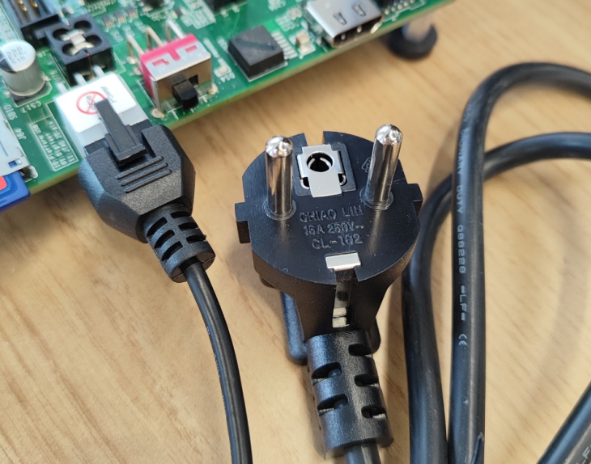
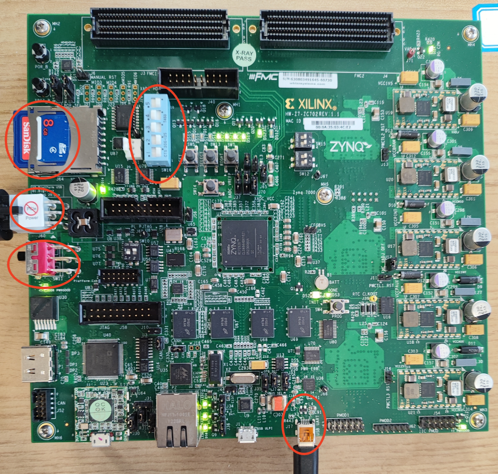
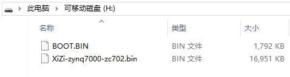
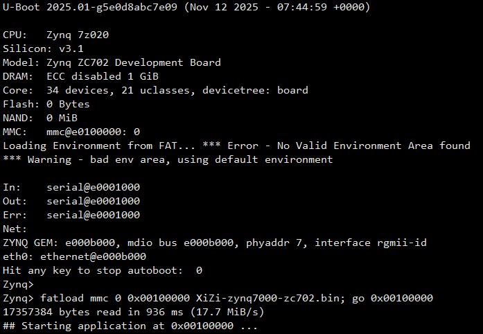
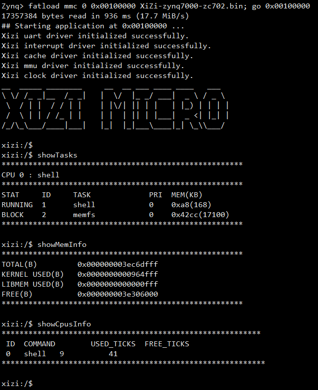

# 从零开始构建矽璓微内核操作系统：ARM架构Zynq7000-ZC702开发板

[XiUOS](http://xuos.io/) (X Industrial Ubiquitous Operating System) 矽璓XiUOS是一款面向智慧车间的工业物联网操作系统，主要由一个极简的微型实时操作系统内核和其上的工业物联框架构成，通过高效管理工业物联网设备、支撑工业物联应用，在生产车间内实现智能化的“感知环境、联网传输、知悉识别、控制调整”，促进以工业设备和工业控制系统为核心的人、机、物深度互联，帮助提升生产线的数字化和智能化水平。

## 开发环境搭建

### 推荐使用：

**操作系统：** Ubuntu 20.04 下载路径：[https://ubuntu.com/download/desktop](https://ubuntu.com/download/desktop)

### 依赖包安装：

```
$ sudo apt install build-essential pkg-config
$ sudo apt install gcc make libncurses5-dev openssl libssl-dev bison flex libelf-dev autoconf libtool gperf libc6-dev  git
```

### 源码下载：

下载矽璓源码，命令如下：

```c
git clone https://gitlink.org.cn/xuos/xiuos.git
```

1、打开XiUOS源码文件包可以看到以下目录：

| 名称          | 说明                                                         |
| ------------- | ------------------------------------------------------------ |
| APP_Framework | 应用代码。                                                   |
| Ubiquitous    | 板级支持包，支持Nuttx_Fusion_XiUOS、RT-Thread_Fusion_XiUOS、XiZi_IIoT_Macro和XiZi_AIoT_Micro。 |


2、打开XiZi_AIoT_Micro微内核源码文件包，可以看到以下目录：

| 名称 | 说明 |
| -- | -- |
| hardkernel | 负责硬件相关的初始化，如时钟驱动、中断处理等底层硬件管理，为上层软内核提供硬件支持。 |
| softkernel | 微内核核心功能实现，如任务管理、内存管理、进程间通信等。 |
| services | 各类服务和应用模块。其中，boards针对不同硬件板卡的适配代码。 |
| Makefile | 构建脚本，支持多架构（ARM、RISC-V）和不同板卡的编译配置。 |


# Zynq7000-ZC702评估套件

## 1. 微处理器简介

| 硬件 | 描述 |
| -- | -- |
|芯片型号| Zynq XC7Z020-1CLG484C |
|CPU| 2核 ARM Cortex-A9 |
|主频| 667MHz |
|内存| 1GB |
|存储| 16MB Quad SPI Flash  + SD卡 |
| 外设 | UART调试 |


## 2. 编译说明

矽璓微内核编译Zynq7000-ZC702需使用 Xilinx 提供的交叉编译工具链：`arm-xilinx-eabi-`。

### 2.1 交叉编译工具链安装和配置

官网提供的 Software Development Kit (SDK) 包含`arm-xilinx-eabi-`工具链，但由于 Zynq7000-ZC702 是较早产品，官网 SDK 包下载链接已失效。

Zynq7000-ZC702 评估套件附带的光盘中包含 SDK（如 Xilinx_SDK_2016.1_0409_1），可从中获取并拷贝到 Ubuntu 系统（或虚拟机）中。

在 Ubuntu 终端进入 Xilinx_SDK_2016.1_0409_1 目录，执行以下命令安装：

```c
sudo ./xsetup
```

注意：安装需通过可视化界面手动选择路径，因此需在 Ubuntu 本机终端操作，不可通过 SSH 远程执行。

假设安装的路径是`/home/data`，安装完成后工具链路径应为：

```c
/home/data/Xilinx/SDK/2016.1/gnu/arm/lin/bin/arm-xilinx-eabi-gcc
```

配置环境变量，在`~/.bashrc`中添加：

```
PATH="/home/data/Xilinx/SDK/2016.1/gnu/arm/lin/bin:$PATH"
```

然后执行：

```
source ~/.bashrc
```

另外，可以从泛在操作系统实验室的gitlink仓库下载 arm-xilinx-eabi 交叉编译工具链，下载路径：
https://gitlink.org.cn/xuos/zynq7000-zc702/tree/master/toolchain%2Farm-xilinx-eabi-toolchain-2016.1.tar.gz

### 2.2 编译微内核

1.在`Ubiquitous/XiZi_AIoT_Micro`中目录下执行：

```c
make distclean
make BOARD=zynq7000-zc702
```

2.若编译成功，将在 build目录下生成：

```c
XiZi-zynq7000-zc702.bin
```

## 3. 开发板连线和启动模式选择

Zynq7000-ZC702评估套件中有3种电源插头，使用大陆标准电源插头（如标有 “CHIAO LIN 16A 250V” 的插头），如图所示。



拨码开关SW16设置为SD卡启动模式(00110)，如图所示。

Mini-B USB接口（USB UART）通过Type-A转Mini-B USB线连接电脑，如图所示。需要安装驱动`Silicon Labs CP210x USB to UART Bridge`（可从网上下载）。串口波特率为115200。

连接完成后，接入电源，插入SD卡并将电源开关拨至 ON 档，如图所示。



## 4. U-Boot获取

基于Zynq7000-ZC702的矽璓微内核需要通过U-Boot引导启动。

Zynq7000-ZC702的U-Boot的镜像文件为`BOOT.BIN`。

文件`BOOT.BIN`可以通过官网获取。`BOOT.BIN`在官网提供Zynq7000板级支持包`ZC702 BSP`中，例如2025-2版本，下载网址（ https://china.xilinx.com/support/download/index.html/content/xilinx/zh/downloadNav/embedded-design-tools/2025-2.html ）搜索关键字`ZC702 BSP`，进行下载。

下载资源需要注册账号，简单注册一下即可。

下载得到板级支持包文件`xilinx-zc702-v2025.2-11160223.bsp`。

将此文件重命名为`xilinx-zc702-v2025.2-11160223.tar.gz`并解压。

解压后可在以下路径找到`BOOT.BIN`：

```c
xilinx-zc702-v2025.2-11160223\xilinx-zc702-2025.2\pre-built\linux\images\BOOT.BIN
```

另外，可以从泛在操作系统实验室的gitlink仓库下载 BOOT.BIN 启动文件，下载路径：
https://gitlink.org.cn/xuos/zynq7000-zc702/tree/master/firmware%2FBOOT.BIN

Zynq7000-ZC702评估套件有附带SD卡。SD卡是默认的FAT32格式。将`BOOT.BIN`和`XiZi-zynq7000-zc702.bin`拷贝到SD卡的根目录。



## 5. XiZi启动

插入SD卡，连接串口工具（波特率 115200），拨动电源开关上电。

U-Boot启动时，串口按任意按键，进入命令行。

执行以下命令加载并运行微内核：

```c
fatload mmc 0 0x00100000 XiZi-zynq7000-zc702.bin; go 0x00100000
```



通过串口查看启动日志，并可输入以下命令查看系统状态：

```c
showTasks
showMemInfo
showCpusInfo
```



