# 1. 开发板简介

| 硬件      | 描述                                                         |
| --------- | ------------------------------------------------------------ |
| 芯片型号  | CH32V208RBT6                                                 |
| CPU       | 单核RISC-V4C                                                 |
| 主频      | 144MHz                                                       |
| 片内SRAM  | 可配：32KB、48KB、64KB                                       |
| 片内FLASH | 可配：160KB、144KB、128KB                                    |
| 外设      | 2Mbps低功耗蓝牙BLE通讯模块、10M以太网MAC+PHY模块、RS485通信接口、LTE 4G等|

# 2. 环境搭建

## 2.1 系统配置

操作系统使用Ubuntu 18.04，下载地址：https://mirrors.tuna.tsinghua.edu.cn/ubuntu-releases/18.04/ 。

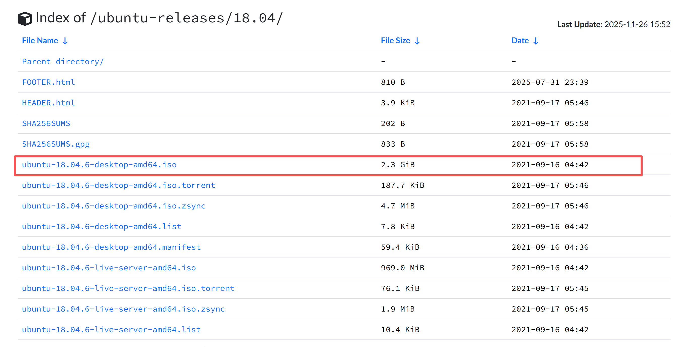

## 2.2 工具安装

### 2.2.1 开发工具
开发工具使用VSCode，下载地址：https://code.visualstudio.com/Download

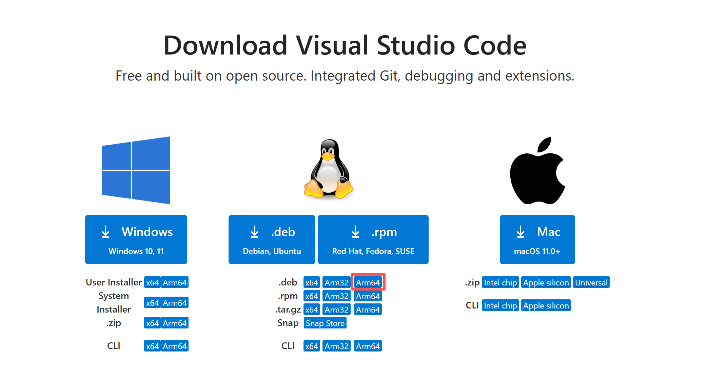

### 2.2.2 依赖包

Ubuntu系统安装好之后，在安装软件之前，或者遇到依赖问题之时，需要安装一些依赖包，它们聚合了一些常用的依赖。另外，还需要安装例如gcc编译器和make命令工具等。具体用到的两条Linux命令如下所示：

```bash
sudo apt install build-essential pkg-config
sudo apt install gcc make libncurses5-dev openssl libssl-dev bison flex libelf-dev autoconf libtool gperf libc6-dev git
```

### 2.2.3 配置工具

Linux编译器通过件.config文件确认哪些代码编译进内核，哪些被裁减掉，与之相关的工具包括menuconfig、Kconfig、Makefile。其中，menuconfig是编辑内核，生成.config的工具；Kconfig定义menuconfig菜单选项；Makefile根据.config宏定义判断是否编译驱动。

对于XiUOS的编译，首先需要下载对应的裁减配置工具：kconfig-frontends，下载地址https://www.gitlink.org.cn/xuos/kconfig-frontends ，然后进行安装即可。上述下载和安装操作可通过Linux命令执行，如下所示。第1条命令用于从确实开源平台下载一个kconfig-frontends至本地；第2条命令是进入下载的kconfig-frontends源码目录；第3条命令是运行XiUOS的build进行配置工具的安装。

```bash
git clone https://gitlink.org.cn/xuos/kconfig-frontends.git
cd kconfig-frontends
./xs_build.sh
```

### 2.2.4 编译工具链

做C语言开发，特别是嵌入式方向，需要涉及编译工具链和交叉编译工具链的相关内容，即C程序需要经过gcc等工具编译成二进制程序才能被计算机使用。这里的gcc通常是泛指，包括gcc、g++、ar、as、ld等一系列工具，这些工具用于完成程序文件的预编译、编译、链接等整个过程，就被称为编译工具链（Toolchain）。

同样，XiUOS的编译也需要安装编译工具链，对应RISC-V的riscv-none-embed-，默认安装到Ubuntu的/opt/目录下。下载网址：https://github.com/xpack-dev-tools/riscv-none-elf-gcc-xpack/releases ：

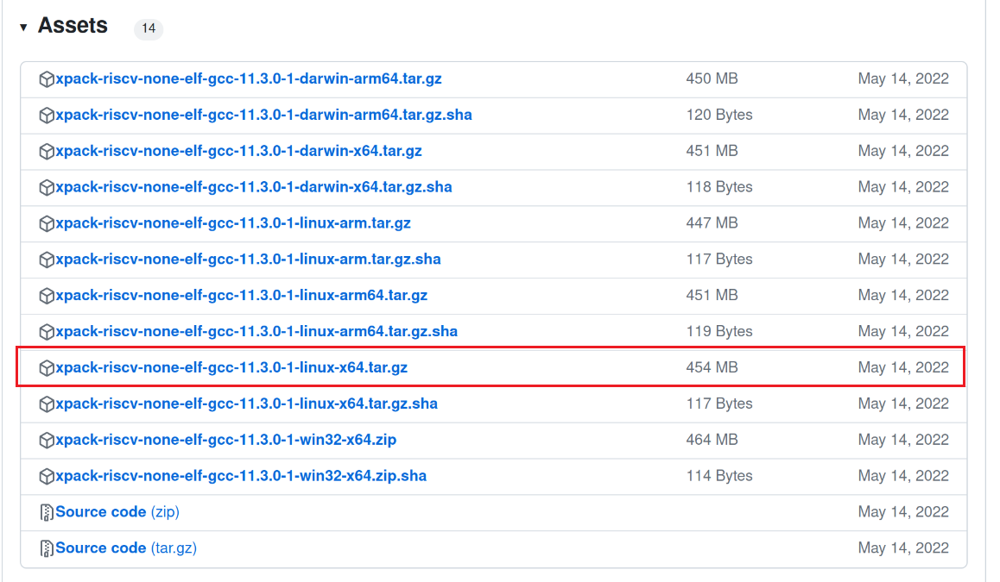

下载并移动到/opt/目录后，解压的Linux命令如下：

```bash
sudo tar -xvzf xpack-riscv-none-elf-gcc-11.3.0-1-linux-x64.tar.gz
```

将上述解压的编译工具链的路径添加到board/aiit-ch32v208rbt6-board/config.mk文件当中，使用的Linux命令如下：

```bash
export CROSS_COMPILE=/opt/xpack-riscv-none-elf-gcc-11.3.0-1/bin/riscv-none-elf-
```

# 3. 源码下载

XiUOS的源码已经发布在确实开源平台，源码下载地址https://www.gitlink.org.cn/xuos/xiuos 。首先使用Linux命令新建一个空文件夹test，并进入该文件夹中。然后，使用命令下载源码至新建的test文件夹。具体用到的两条Linux命令如下：

```bash
mkdir test && cd test
git clone https://gitlink.org.cn/xuos/xiuos.git
```

XiUOS源代码下载好之后，使用VSCode打开源代码，可以进行代码查看和编写，打开方法为：在xiuos目录下打开系统终端，在源码文件夹下输入code . 即可打开VSCode开发环境，进入xiuos/Ubiquitous/XiZi_IIoT_Macro，此目录为代码根目录。

# 4. BLE 配置与 MQTT 数据上报流程

## 4.1 main函数

文件路径：`APP_Framework/Applications/main.c`

将以下代码复制到 main.c 文件中，用于启动相关线程及发送数据：

```c
/*
* Copyright (c) 2020 AIIT XUOS Lab
* XiUOS is licensed under Mulan PSL v2.
* You can use this software according to the terms and conditions of the Mulan PSL v2.
* You may obtain a copy of Mulan PSL v2 at:
*        http://license.coscl.org.cn/MulanPSL2
* THIS SOFTWARE IS PROVIDED ON AN "AS IS" BASIS, WITHOUT WARRANTIES OF ANY KIND,
* EITHER EXPRESS OR IMPLIED, INCLUDING BUT NOT LIMITED TO NON-INFRINGEMENT,
* MERCHANTABILITY OR FIT FOR A PARTICULAR PURPOSE.
* See the Mulan PSL v2 for more details.
*/

#include <stdio.h>
#include <string.h>
// #include <user_api.h>
#include <transform.h>
#include <ModuleConfig.h>
#include <adapter.h>

#ifdef CONFIG_LIB_USING_PIKAPYTHON
#include "../lib/pikapython/pikascript-api/pikaScript.h"
#endif

extern int FrameworkInit();
extern void ApplicationOtaTaskInit(void);

#ifdef CONFIG_LIB_USING_PIKAPYTHON
/* PikaPython application interfaces */
extern PikaObj* pikaPythonInit(void);
#endif

#ifdef OTA_BY_PLATFORM
extern int OtaTask(void);
#endif

#ifdef APPLICATION_WEBSERVER
extern int webserver(void);
#endif

int main(void)
{
    printf("\nHello, world!\n");
    FrameworkInit();
    
#ifdef BSP_BLE_CONFIG
	/* 创建互斥信号量 */
	if (PrivMutexCreate(&romConfigurationMutex, 0) < 0) {
        printf("CFG mutex create failed.\n");
        return 0;
    }
    /* 启动蓝牙主任务线程 */
    void startUpBleTask(void);
    startUpBleTask();

    /* 打开4G模块 */
    struct Adapter *adapter_4G = AdapterDeviceFindByName(ADAPTER_4G_NAME);  // 查找4G模块适配器
	AdapterDeviceOpen(adapter_4G);

    while (!adapter_4G->network_info.mqttIsConnected) { // 等待MQTT连接成功
        PrivTaskDelay(1000);
    }
    printf("MQTT connected! Start sending data.\n");

    // 连接成功后，循环发送数据
    const char *send_data = "I like programming, I like XiUOS\n";
    while (1) {
        AdapterDeviceMqttSend(adapter_4G, CFG->mqttTopic_4G, (void *)send_data, strlen(send_data));
        printf("Sent: %s", send_data);
        PrivTaskDelay(10000); // 每10秒发一次
    }

#endif
    
#ifdef CONFIG_LIB_USING_PIKAPYTHON
    /* Initialize and run PikaPython */
    printf("\n initializing PikaPython...\n");
    PikaObj* pikaMain = pikaPythonInit();
    if (pikaMain != NULL) {
        printf("\n PikaPython test completed successfully!\n");
    } else {
        printf("\n PikaPython initialization failed!\n");
    }
#endif
#ifdef APPLICATION_OTA
    ApplicationOtaTaskInit();
#endif

#ifdef OTA_BY_PLATFORM
    OtaTask();
#endif

#ifdef APPLICATION_WEBSERVER
    webserver();
#endif

    return 0;
}
// int cppmain(void);
```

## 4.2 配置

代码编译具体步骤如下：

在VSCode的“命令终端”，进入xiuos/Ubiquitous/XiZi_IIoT_Macro代码根目录，执行命令:

```bash
make BOARD=aiit-ch32v208rbt6-board distclean # 将之前的编译生成文件清空
make BOARD=aiit-ch32v208rbt6-board menuconfig # 进行编译设置
```

进入配置页面：

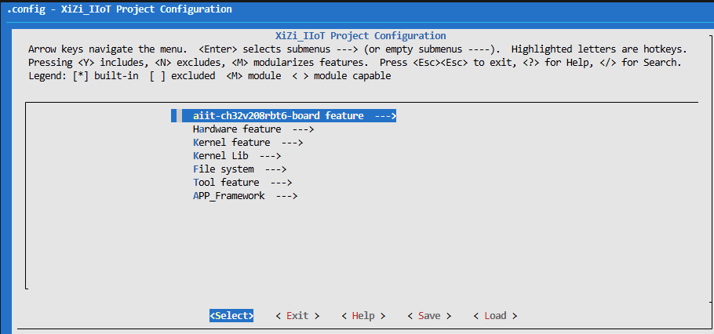

在menuconfig界面可以配置需要关闭或开启的功能，按回车键进入下级菜单，按Y键选中需要开启的功能，按N键选中需要关闭的功能，配置结束后选择Exit保存并退出。

为了通过BLE配置参数，并由MQTT发送数据，需使能UART、BLE以及LTE。

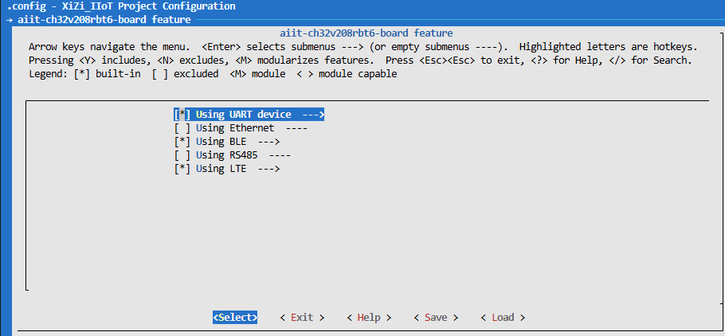

### 4.2.1 Using UART device
路径：`aiit-ch32v208rbt6-board feature`-`Using UART device`-`-Enable UART1`

| 字段                   | 说明         |
| ---------------------- | ------------ |
| serial bus name        | UART总线名称 |
| serial bus driver name | UART驱动名称 |
| serial bus device name | UART设备名称 |

> [!CAUTION]
>
> 在Xizi文件系统中，如果把设备当作文件处理，那么这里的名称需要遵循规范：
>
> - 假设总线名称为`bus`（bus为自定义内容）
> - 驱动名称为`bus_xxx`（xxx为自定义内容）
> - 设备名称为`bus_xxx`（xxx为自定义内容）

此处配置如下，无需更改，默认即可：

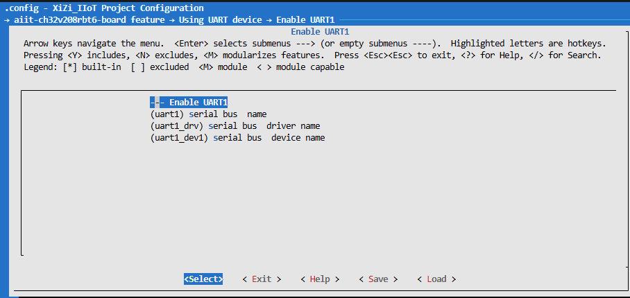

### 4.2.2 Using BLE

路径：`aiit-ch32v208rbt6-board feature`-`Using BLE`，勾选 `Using BLE config`后显示蓝牙相关字段。

| 字段                            | 说明            |
| ------------------------------- | --------------- |
| device ble name                 | 设备蓝牙名称    |
| Device Info System ID Element 0 | 设备系统ID字节0 |
| Device Info System ID Element 1 | 设备系统ID字节1 |
| Device Info System ID Element 2 | 设备系统ID字节2 |
| Device Info System ID Element 3 | 设备系统ID字节3 |
| Device Info System ID Element 4 | 设备系统ID字节4 |
| Device Info System ID Element 5 | 设备系统ID字节5 |
| Device Info System ID Element 6 | 设备系统ID字节6 |
| Device Info System ID Element 7 | 设备系统ID字节7 |
| dev info model number           | 设备模块号      |
| dev info serial number          | 设备序列号      |
| dev info firmware revision      | 设备固件版本    |
| dev info hardware revision      | 设备硬件版本    |
| dev info software revision      | 设备软件版本    |
| dev info manufacturer name      | 设备制造商名称  |

以上字段中，`device ble name`是提供蓝牙主设备扫描后，ch32v208作为蓝牙从设备显示的蓝牙名称。其余字段都是作为蓝牙特征值提供给蓝牙主设备进行读取。

此处配置如下（此处配置对系统无任何影响）：

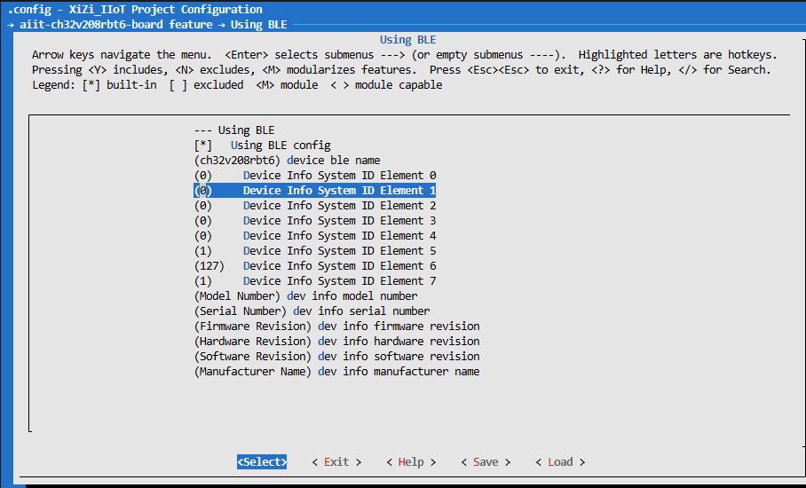

### 4.2.3 Using LTE

路径`aiit-ch32v208rbt6-board`-`Using LTE`

| 字段                  | 说明         |
| --------------------- | ------------ |
| lte bus name          | LTE总线名称  |
| lte bus driver name   | LTE驱动名称  |
| lte bus device 1 name | LTE设备1名称 |

命名规范详见[4.2.1 Using UART device]，此处配置如下，无需更改，默认即可：

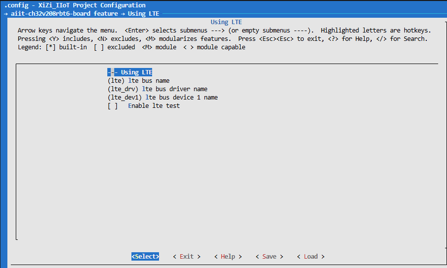

### 4.2.4 Command shell

路径：`kernel feature`-`Command shell`-`Enable letter-shell function`-`Set shell config param`

| 字段                         | 说明                  |
| ---------------------------- | --------------------- |
| Set the stack size for shell | shell线程的栈空间大小 |

默认启用 Shell 以方便调试。若用于资源受限的工程场景（如多线程应用），为节省 RAM，可选择禁用 Shell。默认配置如下：

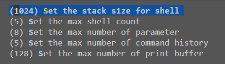

### 4.2.5 File System

路径：`File System`-`Using device virtual file system`

| 字段                        | 说明                        |
| --------------------------- | --------------------------- |
| Using dev object for FS_VFS | 在虚拟文件系统中使用dev对象 |

配置该项主要是将设备dev也当作文件来处理，并且在应用层可以使用`PrivOpen`、`PrivRead`等函数来操控设备。

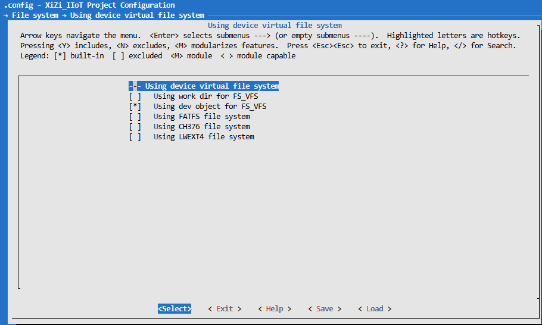

### 4.2.6 Framework

路径：`APP_Framework`-`Framework`

MQTT发送需勾选框架中的“联”部分：

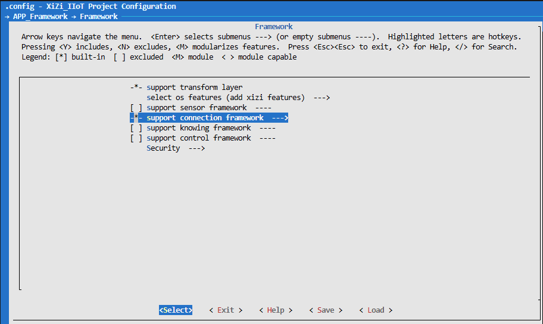

勾选4G设备：

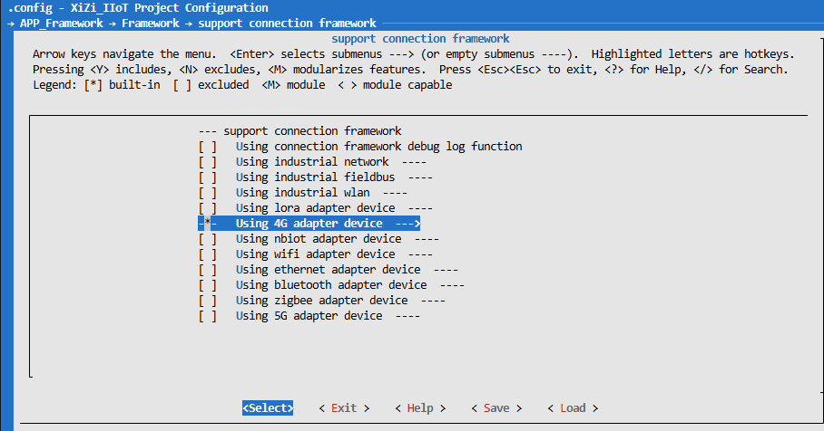

选择EC801E：

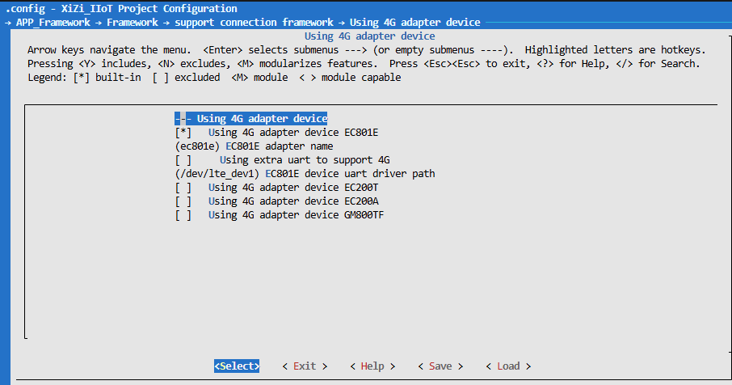

保存配置：

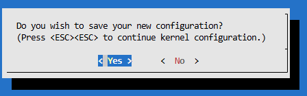

生成配置文件.config。

## 4.3 编译

保存好配置后，输入以下命令进行编译：

```bash
make BOARD=aiit-ch32v208rbt6-board
```

编译完成后会在`Ubiquitous/XiZi_IIoT_Macro/build`目录中生成`XiZi-aiit-ch32v208rbt6-board.bin`文件，将该文件拷贝至Windows侧待下一步进行烧录。

对比 build 目录中的输出文件，.bin 为纯二进制镜像，无地址元数据，体积明显小于包含地址信息的 .hex 文件，因此后续烧录和部署将优先使用 .bin 格式以节省存储与传输开销。

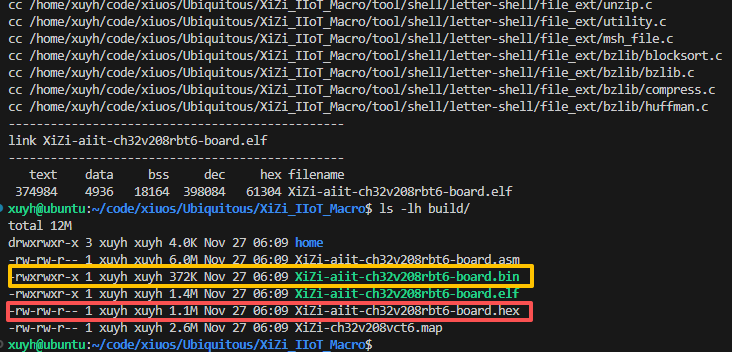

在日常开发过程中，如果配置未发生变化，可直接执行`make BOARD=aiit-ch32v208rbt6-board`进行增量编译，以加快编译速度；如编译过程中报错，可先执行`make BOARD=aiit-ch32v208rbt6-board clean`清除后再执行`make BOARD=aiit-ch32v208rbt6-board`再重新编译，无需执行`make BOARD=aiit-ch32v208rbt6-board menuconfig`进行配置。

## 4.4 端口连接

`ch32v208rbt6`需要使用`WCH-LINK`模块以及`Type-C`数据线进行串口连接。WCH-Link模块可用于沁恒RISC-V架构MCU在线调试和下载, 也可用于带有SWD/JTAG接口的ARM内核MCU在线调试和下载。同时带有一路串口, 方便调试输出。WCH-Link模块图片如下：

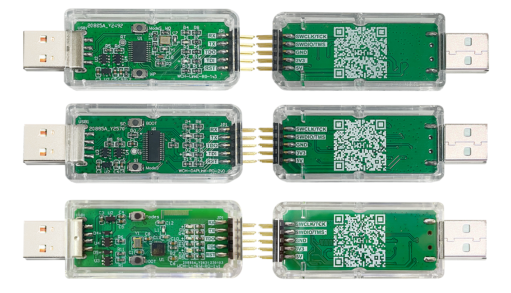

更详细的模块说明可查看沁恒官网：https://www.wch.cn/products/WCH-Link.html 。

购买链接为：https://item.taobao.com/item.htm?_u=r1mvuf4k1a09&id=642246959270&spm=a1z09.2.0.0.3dfa2e8dd7F0vL&skuId=4923747048856 ，选择WCH-LinkE 1v3版本，如图：

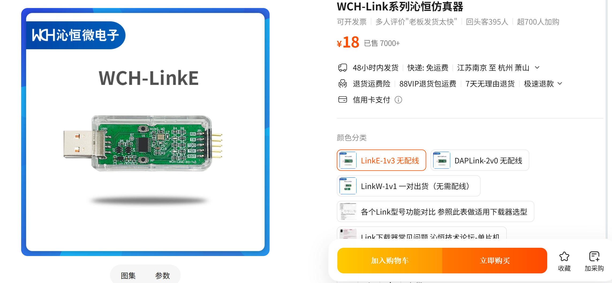

各个端口的连接如下：
### J2 为 SWD 烧录/调试接口，用于将固件镜像下载到开发板

| 接口组别       | ch32v208rbt6 | WCH-LINK |
| -------------- | ------------ | -------- |
| J2（编程接口） | GND          | GND      |
| J2（编程接口） | DIO          | SWDIO    |
| J2（编程接口） | CLK          | SWCLK    |
| J2（编程接口） | 3V3          | 3V3      |

### J6为`Type-C`接口，通过 USB 与电脑连接，用于日志输出与调试信息查看

连接后如下：

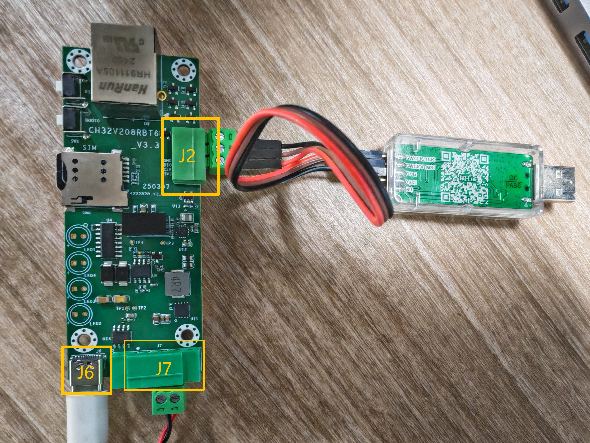

整体接线图如下：

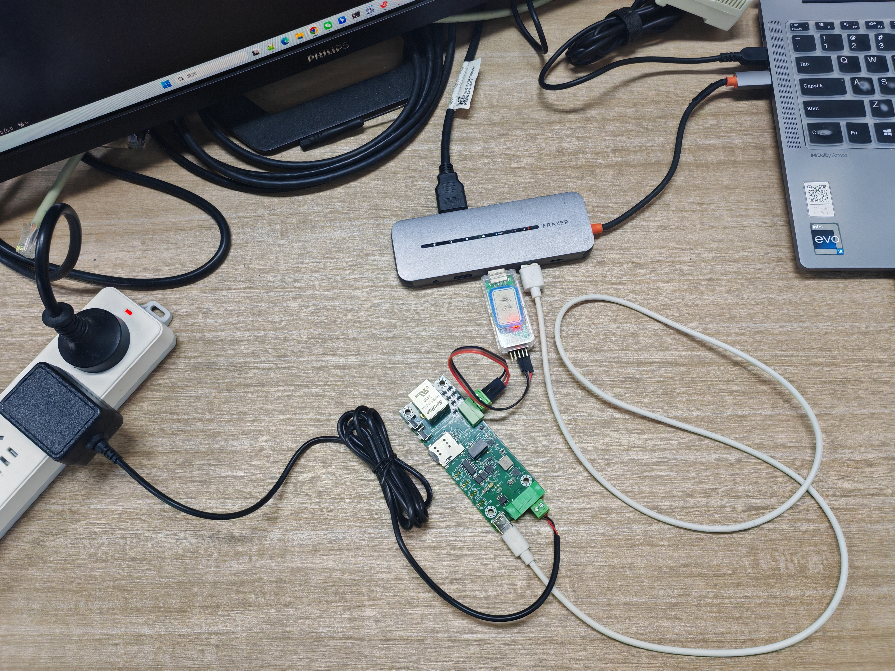

## 4.5 WCH-LINK模块固件更新（可选）

如WCH-LINK模块蓝灯闪烁，代表其固件缺失，需要进行固件烧录或者更新。

可以使用[MounRiver Studio](http://www.mounriver.com/download)在线更新。更新步骤如下：

1. 将WCH-LINK连接至电脑。

2. 打开MounRiver Studio，点击`download`图标右边的向下箭头，点击`configuration`，如下所示：

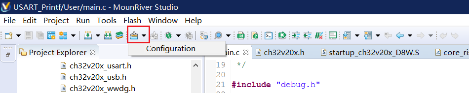

3. 显示窗口后，点击任意`query`按钮即可进行固件更新，如下：

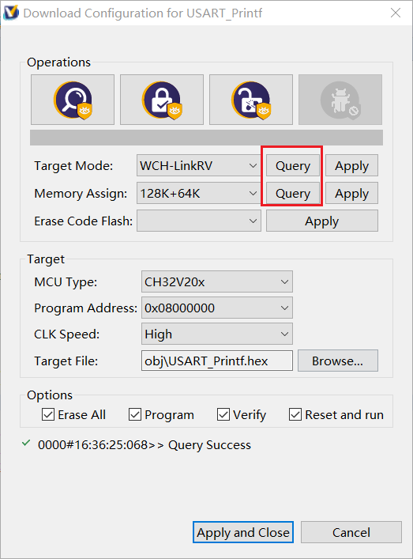

4. 待WCH-LINK模块红灯亮起，表示固件更新完成。

## 4.6 烧录

1. 下载`WCH-LinkUtility`工具：https://www.wch.cn/downloads/WCH-LinkUtility_ZIP.html

2. ch32v208rbt6连接电源线（最右侧端口为`IN`，对应红线；其左边端口为`GND`，对应黑线，可查看开发板背部标识确认），如下：

   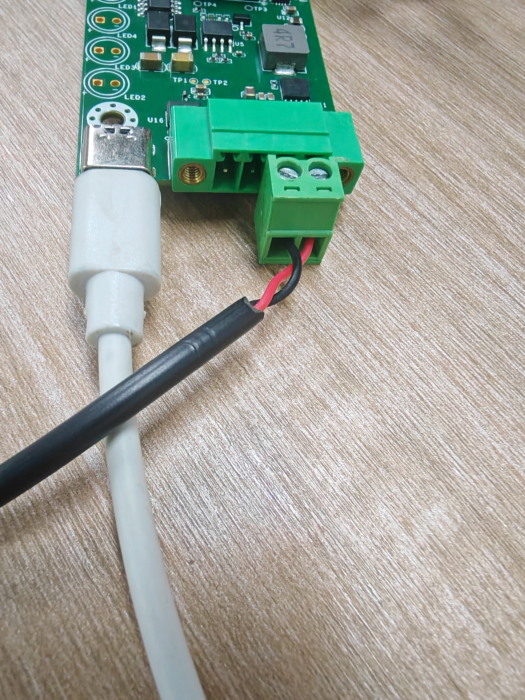

电源为9-36V宽电压输入，一般选择12V或24V，可参考购买链接：https://item.taobao.com/item.htm?abbucket=19&id=689858670268&ns=1&priceTId=213e376517313763377208724ec911&skuId=5079415894631&spm=a21n57.1.item.47.9cf1523cUlEGfk&utparam=%7B%22aplus_abtest%22%3A%2263c7f3fc4de39798d69de83700f169d3%22%7D&xxc=taobaoSearch

选择12V1A输出裸线版本：

   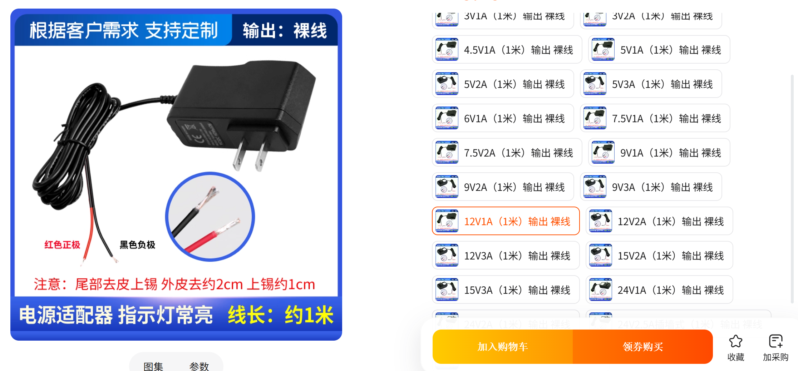

3. 将WCH-LINK连接至电脑，设备管理器显示`WCH-LinkRV`表示连接成功，如下：

   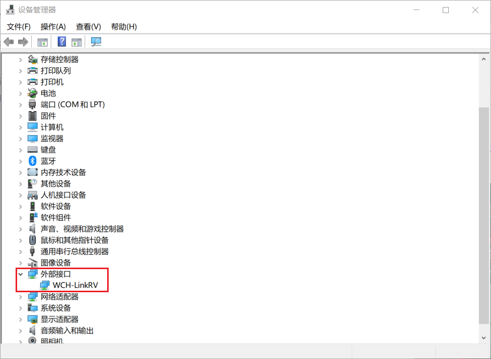

4. 打开烧录软件WCH-LinkUtility，如下：

   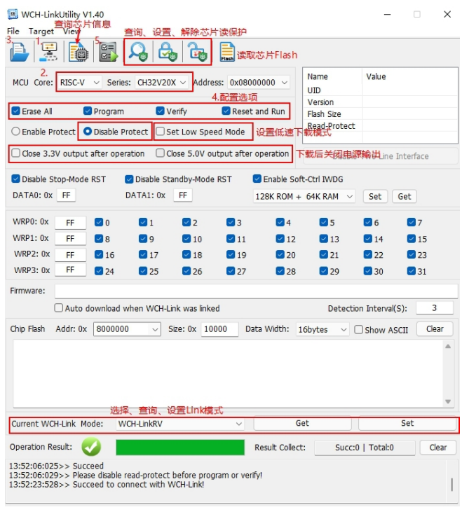

   1）连接 WCH-Link。

   2）选择芯片信息，`MCU Core`选择`RISC-V`，`Series`选择`CH32V20X`。

   3）添加固件，即[2. 编译](# 2. 编译)中编译好的`XiZi-aiit-ch32v208rbt6-board.bin`文件。

   4）设置配置选项，若芯片为读保护需解除芯片读保护。

   5）执行。
   
### 指定ROM和RAM大小

> 参考资料：
>
> https://www.cnblogs.com/gscw/p/17286307.html

> [!caution]
>
> WCH-LinkUtility中需要指定ROM和RAM大小，如果大小与源文件`link.ld`中的ROM和RAM大小不一致，可能会导致XiZi启动失败。

在WCH_LinkUtility中，在以下位置指定ROM和RAM大小：

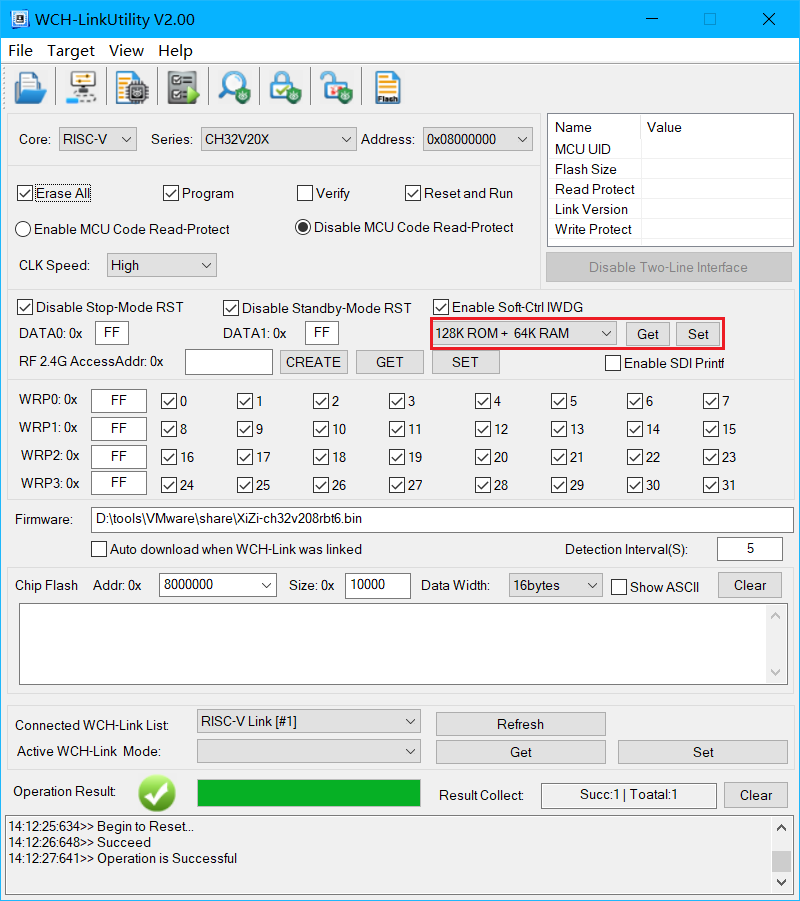

其中，set按钮用于设置CH32V208的ROM和RAM大小，get按钮用于获取CH32V208的当前ROM和RAM大小。

在`Ubiquitous/XiZi_IIoT_Macro/board/aiit-ch32v208rbt6-board/link.ld`中，在以下代码位置配置ROM和RAM大小：

```c
/* CH32V20x_D8 - CH32V203RB
   CH32V20x_D8W - CH32V208x
   FLASH + RAM supports the following configuration
   FLASH-128K + RAM-64K
   FLASH-144K + RAM-48K
   FLASH-160K + RAM-32K
*/
   FLASH (rx) : ORIGIN = 0x00000000, LENGTH = 448K
   RAM (xrw) : ORIGIN = 0x20000000, LENGTH = 64K
```

以下是测试成功的RAM和ROM大小配置，如果编译时显示RAM或者ROM不足，则需要调整RAM或者ROM。推荐使用下面的慢速FLASH配置。

1. 仅使用快速FLASH

   | link.ld                   | WCH-LinkUtility    |
   | ------------------------- | ------------------ |
   | 128K（FLASH）+ 64K（RAM） | 128K ROM + 64K RAM |
   | 144K（FLASH）+ 48K（RAM） | 144K ROM + 48K RAM |
   | 160K（FLASH）+ 32K（RAM） | 160K ROM + 32K RAM |

2. 使用慢速FLASH

   | link.ld                   | WCH-LinkUtility    |
   | ------------------------- | ------------------ |
   | 448K（FLASH）+ 64K（RAM） | 128K ROM + 64K RAM |

## 4.7 启动

烧录完成后，并且将Type-C连接至电脑串口。

按下ch32v208rbt6板上的`RST`按钮，即可看到操作系统启动的信息，如下：

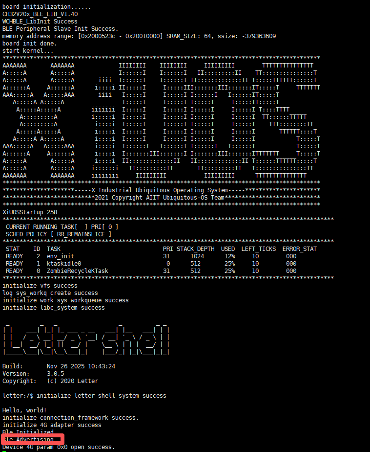

可以看到系统顺利启动，且蓝牙已启动监听。

扫描下面二维码打开微信小程序（小程序已开源，gitlink仓库地址：https://www.gitlink.org.cn/xuos/XiUOS-WeChat-Mini-Program ,用户也可以以开发者的身份本地运行调试）：


搜索到对应名称的蓝牙：

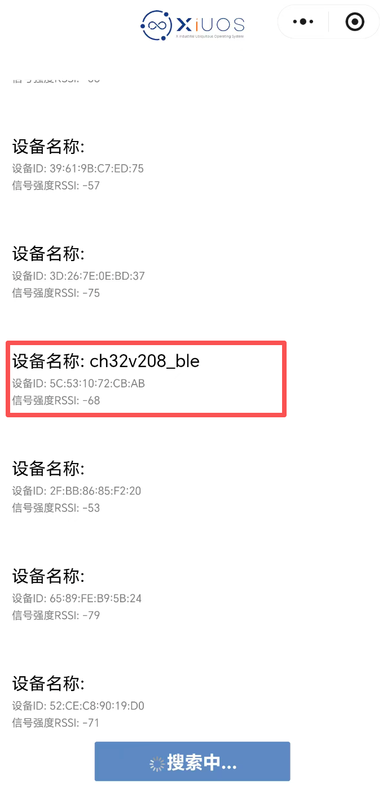

若第一次配对，需要PIN码，默认为为`000000`，点击设备进入设置页面，切换到`4G`，打开`MQTT`开关：

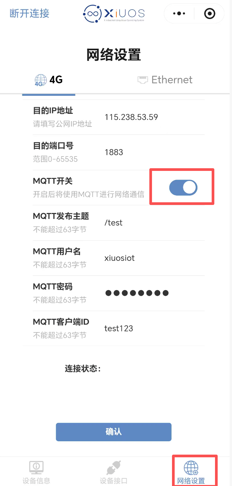

填入相应的配置信息，这里提供一个公用测试配置，IP为`115.238.53.59`，端口为`1883`，主题可任意，只要接受消息订阅为同一个即可，用户名为`xiuosiot`，密码为`xiuosiot`，客户端ID任意，不重复即可。

连接成功后，小程序状态为`连接成功`：

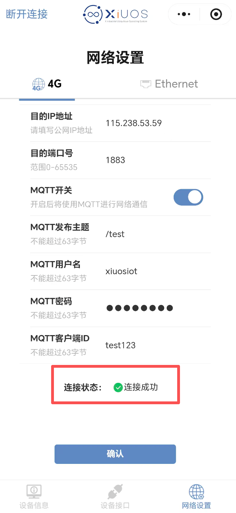

日志显示开始发送数据：

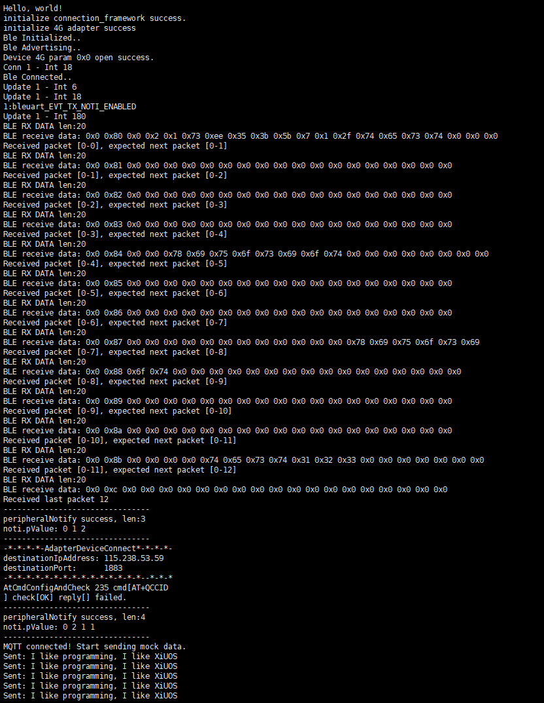

通过MQTTX工具（下载地址：https://mqttx.app/zh/downloads ）订阅前面所发布的主题，可以看到接收消息成功：

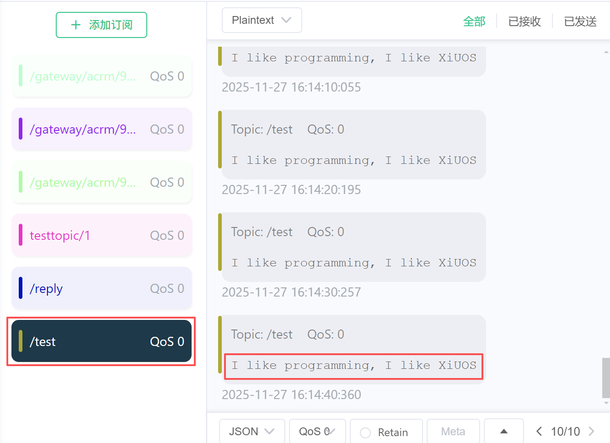

# 5. 技术支持

如有任何问题或建议，欢迎通过以下方式联系我们：

- 🐞 在 [GitLink](https://www.gitlink.org.cn/xuos/xiuos) 上提交 Issue  
- ✉️ 发送邮件至 [xyh1120131893@163.com](mailto:xyh1120131893@163.com)